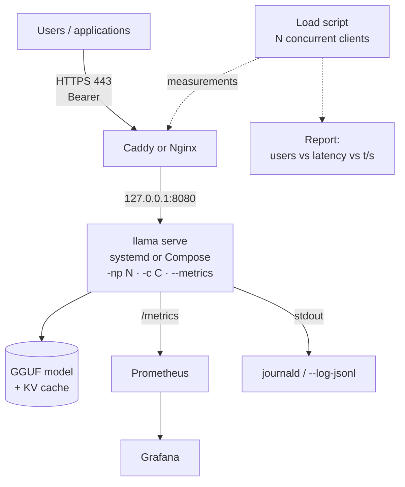

# P2: Inference server in production

:material-book-open-page-variant:{ .meta-icon } Modules [04](../../moduli/04-server-api/README.md), [05](../../moduli/05-prestazioni/README.md), [09](../../moduli/09-deploy-produzione/README.md)
:material-target:{ .meta-icon } Difficulty ●●○

## Description

Put an **OpenAI-compatible** endpoint into production on a Linux machine (VM, VPS or lab
server): HTTPS, API key authentication, automatic startup, monitoring with dashboards and, above all,
a **sizing report** that answers the question every customer asks: "how many users can this
machine handle, and at what latency?". This is the DevOps/MLOps track project: little code, a lot of configuration,
a lot of measurements.

## Architecture

## Minimum requirements

- Reproducible deploy: systemd unit **or** `compose.yaml`, with a healthcheck on `/health`, automatic restart and an unprivileged user.
- Reverse proxy with HTTPS (Let's Encrypt, or an internal certificate if you have no domain) and API keys (`--api-key-file`), `/health` public.
- `--metrics` + Prometheus + a Grafana dashboard with at least 5 panels (tokens/s, requests in progress/queued, busy slots, cache hits, up).
- Load script (you can start from [`carico.py`](../../laboratori/lab-09-02-proxy-monitoraggio/carico.py)) that measures time to first token, total latency and aggregate throughput with 1, 2, 4, 8, 16 concurrent clients.
- Sizing report: table and chart "concurrent clients → p50/p95 time to first token, tokens/s per client and aggregate" for at least two `-np`/`-c` configurations and, if possible, two models.
- Written update and rollback procedure, **tested** (with the previous build kept).

## Extensions for full marks

- **Speculative decoding** (`-md` + `--spec-type draft-simple`, or `--hf-repo-draft … --spec-type draft-mtp` with gemma-4): measure the gain under load, not just with 1 client.
- **Quantized KV cache** (`-ctk q8_0 -ctv q8_0`) and `--kv-unified`: effect on RAM and on how many clients you can handle.
- **Router mode** with two models (chat + embedding) and `--models-max`, per-model metrics.
- Rate limiting in the proxy and proof that it works (429 above the threshold).
- Alerting: a Prometheus rule on `requests_deferred` and on `up`, with a notification (even just a test webhook).
- Cluster: two machines with RPC (module 05) or two instances behind a load balancer (`/slots?fail_on_no_slot=1`).

## Suggested milestones

| Week | Goal | Verifiable result |
|---|---|---|
| 1 | Service + proxy + key, healthcheck, `/metrics` scraped | `curl https://…/v1/chat/completions` answers; target UP in Prometheus |
| 2 | Load script, measurements with 1-16 clients, two configurations, dashboard | sizing table and chart |
| 3 | Tested update/rollback, extension, README, report, demo | a grader recreates the deploy from scratch |

## Recommended models

| Role | Repository | File / quant | Size | Notes |
|---|---|---|---|---|
| Service on CPU, 8 GB | `ggml-org/Qwen3.5-0.8B-GGUF` | Q8_0 | 785 MiB | thinking off by default in the service (`--reasoning-budget 0` or `-rea off`) |
| Service on CPU, 16 GB | `ggml-org/gemma-3-4b-it-qat-GGUF` | Q4_0 | 2.4 GiB | much better quality, ~3-4× slower |
| With GPU (≥ 8 GB VRAM) | `ggml-org/gemma-4-E4B-it-GGUF` | Q4_0 | 4.3 GiB (+ mtp 57 MiB) | `--hf-repo-draft` same repo + `--spec-type draft-mtp` |
| With GPU (≥ 16 GB VRAM) | `ggml-org/gpt-oss-20b-GGUF` | MXFP4 | 11.3 GiB | the `eagle3-gpt-oss-20b` draft is in the same repo |
| Draft for speculative decoding (CPU) | `ggml-org/Qwen2.5-Coder-0.5B-Q8_0-GGUF` with `ggml-org/Qwen2.5-Coder-7B-Q8_0-GGUF` | Q8_0 | 506 MiB + 7.5 GiB | pair used by the official `--fim-qwen-7b-spec` presets |
| Embedding (router mode) | `ggml-org/embeddinggemma-300M-GGUF` | Q8_0 | 318 MiB | `--embedding` in the `.ini` preset |

## Specific grading criteria

- The deploy starts from a clean machine by following the README, with no undocumented "manual" steps.
- The server is **not** reachable without a key and does not listen on `0.0.0.0` on the host (`ss -ltnp` in the report).
- The sizing report has p50 and p95, not just averages; the measurement conditions are written down (model, `-np`, `-c`, `-t`, hardware, `max_tokens`).
- The rollback procedure was actually carried out (log or screenshot with the two builds).
- The dashboard shows the load test (screenshot with `requests_deferred` > 0).

## Known pitfalls

- Measuring load **from the same machine** that serves the model steals CPU from the server: if you can, run the script from another host, or at least note the distortion.
- A different `max_tokens` between runs makes comparisons useless: fix it (e.g. 64) and use the same prompts.
- A high `-np` on CPU does not increase aggregate throughput: your report shows it, there is no need to hide it.
- The proxy timeout (Caddy `response_header_timeout`, Nginx `proxy_read_timeout`) is the first thing that trips with 16 clients: read the 502s in the proxy log, not just the client errors.
- If you update with `llama update` without copying the binary, you roll back with the installer's `LLAMA_VERSION=bNNNNN`: know which build you had (`llama version` in the README).
- `/metrics` is not public: Prometheus needs the Bearer token; `/health` is public.
- With `MemoryMax` (systemd) or `limits.memory` (Compose) set too low, the server gets killed while loading: read `journalctl`/`docker compose logs`.

## Deliverables

- Repository with README, reproducible startup instructions and the llama.cpp version used.
- Configuration files (unit/compose, Caddyfile or nginx.conf, prometheus.yml, dashboard JSON) with secrets redacted.
- Sizing report with table, chart and measurement conditions; log of the rollback test.
- Short report (problems encountered, choices, measurements) and 5-minute demo.

## Grading

See the [common rubric](../README.md#grading-rubric) plus the specific criteria above.
