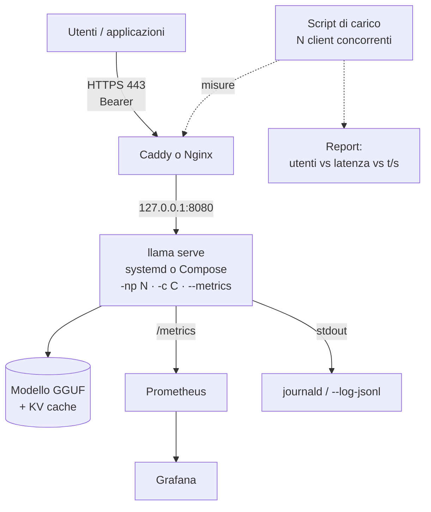

# P2: Server di inferenza in produzione

:material-book-open-page-variant:{ .meta-icon } Moduli [04](../../moduli/04-server-api/README.md), [05](../../moduli/05-prestazioni/README.md), [09](../../moduli/09-deploy-produzione/README.md)
:material-target:{ .meta-icon } Difficoltà ●●○

## Descrizione

Mettere in produzione un endpoint **compatibile OpenAI** su una macchina Linux (VM, VPS o server di
laboratorio): HTTPS, autenticazione con chiavi API, avvio automatico, monitoraggio con dashboard e, soprattutto,
un **report di dimensionamento** che risponde alla domanda che ogni cliente fa: "quanti utenti reggo con questa
macchina e con quale latenza?". È il progetto del percorso DevOps/MLOps: poco codice, molta configurazione,
molte misure.

## Architettura

## Requisiti minimi

- Deploy riproducibile: unità systemd **o** `compose.yaml`, con healthcheck su `/health`, riavvio automatico e utente non privilegiato.
- Reverse proxy con HTTPS (Let's Encrypt o certificato interno se non hai un dominio) e chiavi API (`--api-key-file`), `/health` pubblico.
- `--metrics` + Prometheus + dashboard Grafana con almeno 5 pannelli (token/s, richieste in corso/in coda, slot occupati, cache hit, up).
- Script di carico (puoi partire da [`carico.py`](../../laboratori/lab-09-02-proxy-monitoraggio/carico.py)) che misura latenza al primo token, latenza totale e throughput aggregato con 1, 2, 4, 8, 16 client concorrenti.
- Report di dimensionamento: tabella e grafico "client concorrenti → latenza p50/p95 al primo token, token/s per client e aggregati" per almeno due configurazioni di `-np`/`-c` e, se possibile, due modelli.
- Procedura scritta di aggiornamento e rollback, **provata** (con la build precedente conservata).

## Estensioni per il punteggio pieno

- **Decodifica speculativa** (`-md` + `--spec-type draft-simple`, o `--hf-repo-draft … --spec-type draft-mtp` con gemma-4): misura del guadagno sotto carico, non solo a 1 client.
- **KV cache quantizzata** (`-ctk q8_0 -ctv q8_0`) e `--kv-unified`: effetto su RAM e su quanti client reggi.
- **Router mode** con due modelli (chat + embedding) e `--models-max`, metriche per modello.
- Rate limiting nel proxy e prova che funziona (429 oltre la soglia).
- Alerting: regola Prometheus su `requests_deferred` e su `up`, notifica (anche solo un webhook di prova).
- Cluster: due macchine con RPC (modulo 05) o due istanze dietro un bilanciatore (`/slots?fail_on_no_slot=1`).

## Tappe suggerite

| Settimana | Obiettivo | Risultato verificabile |
|---|---|---|
| 1 | Servizio + proxy + chiave, healthcheck, `/metrics` raccolto | `curl https://…/v1/chat/completions` risponde; target UP in Prometheus |
| 2 | Script di carico, misure con 1-16 client, due configurazioni, dashboard | tabella e grafico di dimensionamento |
| 3 | Aggiornamento/rollback provato, estensione, README, relazione, demo | un valutatore ricrea il deploy da zero |

## Modelli consigliati

| Ruolo | Repository | File / quant | Dimensione | Note |
|---|---|---|---|---|
| Servizio su CPU 8 GB | `ggml-org/Qwen3.5-0.8B-GGUF` | Q8_0 | 785 MiB | thinking spento di default nel servizio (`--reasoning-budget 0` o `-rea off`) |
| Servizio su CPU 16 GB | `ggml-org/gemma-3-4b-it-qat-GGUF` | Q4_0 | 2,4 GiB | qualità molto migliore, ~3-4× più lento |
| Con GPU (≥ 8 GB VRAM) | `ggml-org/gemma-4-E4B-it-GGUF` | Q4_0 | 4,3 GiB (+ mtp 57 MiB) | `--hf-repo-draft` stesso repo + `--spec-type draft-mtp` |
| Con GPU (≥ 16 GB VRAM) | `ggml-org/gpt-oss-20b-GGUF` | MXFP4 | 11,3 GiB | il draft `eagle3-gpt-oss-20b` è nello stesso repo |
| Draft per speculativa (CPU) | `ggml-org/Qwen2.5-Coder-0.5B-Q8_0-GGUF` con `ggml-org/Qwen2.5-Coder-7B-Q8_0-GGUF` | Q8_0 | 506 MiB + 7,5 GiB | coppia usata dai preset ufficiali `--fim-qwen-7b-spec` |
| Embedding (router mode) | `ggml-org/embeddinggemma-300M-GGUF` | Q8_0 | 318 MiB | `--embedding` nel preset `.ini` |

## Criteri specifici di valutazione

- Il deploy parte da una macchina pulita seguendo il README, senza passaggi "a mano" non documentati.
- Il server **non** è raggiungibile senza chiave e non ascolta su `0.0.0.0` sul host (`ss -ltnp` nella relazione).
- Il report di dimensionamento ha p50 e p95, non solo medie; le condizioni di misura sono scritte (modello, `-np`, `-c`, `-t`, hardware, `max_tokens`).
- La procedura di rollback è stata eseguita davvero (log o screenshot con le due build).
- La dashboard mostra il test di carico (screenshot con `requests_deferred` > 0).

## Insidie note

- Misurare il carico **dalla stessa macchina** che serve il modello ruba CPU al server: se puoi, lancia lo script da un altro host, o almeno annota la distorsione.
- `max_tokens` diverso tra prove rende i confronti inutili: fissalo (es. 64) e usa gli stessi prompt.
- `-np` alto su CPU non aumenta il throughput aggregato: lo dimostra il tuo report, non serve nasconderlo.
- Il timeout del proxy (Caddy `response_header_timeout`, Nginx `proxy_read_timeout`) è la prima cosa che scatta con 16 client: leggi i 502 nel log del proxy, non solo gli errori del client.
- Se aggiorni con `llama update` senza copiare il binario, il rollback lo fai con `LLAMA_VERSION=bNNNNN` dell'installer: sappi quale build avevi (`llama version` nel README).
- `/metrics` non è pubblico: Prometheus ha bisogno del Bearer; `/health` invece sì.
- Con `MemoryMax` (systemd) o `limits.memory` (Compose) troppo bassi il server viene ucciso durante il caricamento: leggi `journalctl`/`docker compose logs`.

## Consegna

- Repository con README, istruzioni di avvio riproducibili e versione di llama.cpp usata.
- File di configurazione (unità/compose, Caddyfile o nginx.conf, prometheus.yml, JSON della dashboard) con i segreti oscurati.
- Report di dimensionamento con tabella, grafico e condizioni di misura; log della prova di rollback.
- Breve relazione (problemi incontrati, scelte, misure) e demo di 5 minuti.

## Valutazione

Vedi [griglia comune](../README.md#griglia-di-valutazione) più i criteri specifici sopra.
