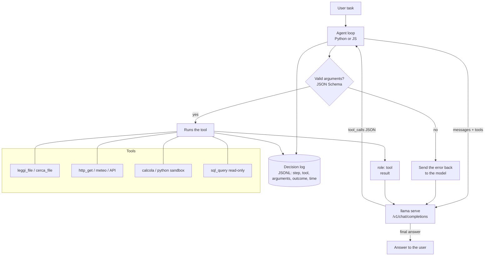

# P3: Agent with tools

:material-book-open-page-variant:{ .meta-icon } Modules [04](../../moduli/04-server-api/README.md), [06](../../moduli/06-output-strutturato/README.md), [08](../../moduli/08-integrazione-sviluppo/README.md)
:material-target:{ .meta-icon } Difficulty ●●●

## Description

A local agent that solves multi-step tasks using real **tools**: reading and searching files,
querying the web or a public API, doing calculations, querying a database. The model decides which
tool to call and with which arguments through the **tool calling** of the OpenAI-compatible API of
`llama serve`; your code runs the tool, returns the result and repeats until the task is
solved. The hard part is not getting a tool called: it is doing it **with small models**, handling
errors and knowing when to stop.

## Architecture

## Minimum requirements

- At least **3 real tools** (not fake ones): for example `cerca_file` + `leggi_file` on the filesystem in a confined folder, `http_get` to a public API (weather, Wikipedia, exchange rates), `calcola` (math expressions evaluated safely), read-only `sql_query` on SQLite.
- Agent loop with a maximum number of steps, a per-tool timeout and handling of: invalid arguments, a failing tool, a model that answers with text instead of a call, repeated identical calls.
- Structured output (module 06): arguments are validated with JSON Schema; the final answer can be constrained with `response_format`.
- **Decision log** in JSONL: for each step the model, the chosen tool, the arguments, the outcome, the duration.
- A set of at least 15 tasks with expected result; comparison of **two models** (success rate, average steps, time, wrong calls).

## Extensions for full marks

- A tool that changes state (writing a file, sending a message) with **human confirmation** and an allow-list: show how you defend against a document containing prompt injection.
- Minimal web UI with streaming of the agent's steps.
- Memory across sessions (a summary of previous conversations in a file) and a measurement of how much it helps.
- Use of `/v1/responses` or the Anthropic-compatible `/v1/messages` API instead of `/v1/chat/completions`, with a comparison.
- A "run Python code" tool in a throwaway container (`docker run --rm --network none`).
- Comparison of `--reasoning` on/off (for thinking models) on success rate and time.

## Suggested milestones

| Week | Goal | Verifiable result |
|---|---|---|
| 1 | Loop with 1 tool (`calcola`) and one model; then 3 tools | "what is 12% of 850 and what's the weather in Bologna?" solved in 2 steps |
| 2 | Task set, JSONL log, error handling, comparison of 2 models | success/steps/time table per model |
| 3 | Extension (security or UI), README, report, demo | a classmate runs 3 tasks and reads the log |

## Recommended models

| Role | Repository | File / quant | Size | Notes |
|---|---|---|---|---|
| Tiny baseline (8 GB) | `ggml-org/functiongemma-270m-it-GGUF` | q8_0 | 278 MiB | trained for function calling; only calls, poor at conversation |
| Small (8 GB) | `ggml-org/Qwen3.5-0.8B-GGUF` | Q8_0 | 785 MiB | native tool calling in the template; try thinking on/off |
| Medium (16 GB) | `unsloth/Qwen3.5-4B-GGUF` | Q4_K_M | 2.6 GiB | the best on CPU for this project |
| Medium (16 GB, alternative) | `ggml-org/gemma-3-4b-it-qat-GGUF` | Q4_0 | 2.4 GiB | gemma template: check tool support with `/props` |
| With GPU | `ggml-org/gpt-oss-20b-GGUF` | MXFP4 | 11.3 GiB | excellent with tools, "harmony" format handled by the server |

Startup: `llama serve -hf unsloth/Qwen3.5-4B-GGUF:Q4_K_M -c 8192 --jinja` (`--jinja` is already the default; tools need the
model's template). Official documentation on tool calling: `docs/function-calling.md`.

## Specific grading criteria

- Tools are real and confined (no access outside the folder, no `eval` on model input).
- The loop always terminates: step limit, timeout, cycle detection (demonstrated with an impossible task).
- The log lets you reconstruct every decision afterwards; the report analyzes at least 3 error cases from it.
- The model comparison uses the same tasks and the same code; numbers come with measurement conditions.
- Prompt injection: at least one documented test (a file read by the agent contains hostile instructions) and what happens.

## Known pitfalls

- Small models **invent tools** or arguments with wrong names: validate against the schema and send the error back as a `tool` message; they often get it right on the second try.
- Tool descriptions that are too long consume context and confuse small models: clear names, a one-line description, few parameters.
- `tool_choice: "required"` forces a call even when none is needed: use it only in the first step, then `auto`.
- Qwen3.5's thinking improves decisions but slows things down a lot on CPU: measure both with `--reasoning-budget`.
- Streaming responses with tool calls arrive in pieces (`delta.tool_calls`): reassemble the arguments before parsing the JSON, or turn off streaming during calls.
- A public API that changes or goes down breaks the demo: provide a "recorded" mode (saved responses) for the evaluation set.
- Don't put external API keys in the system prompt: the model can repeat them; keep them in the tool's code.

## Deliverables

- Repository with README, reproducible startup instructions and the llama.cpp version used.
- Task set, JSONL logs of the runs, comparison table of the two models.
- Short report (problems encountered, choices, measurements) with the analysis of at least 3 agent errors, and 5-minute demo.

## Grading

See the [common rubric](../README.md#grading-rubric) plus the specific criteria above.
