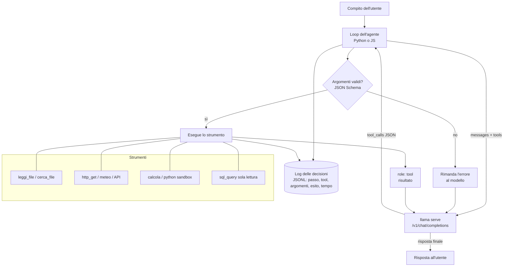

# P3: Agente con strumenti

:material-book-open-page-variant:{ .meta-icon } Moduli [04](../../moduli/04-server-api/README.md), [06](../../moduli/06-output-strutturato/README.md), [08](../../moduli/08-integrazione-sviluppo/README.md)
:material-target:{ .meta-icon } Difficoltà ●●●

## Descrizione

Un agente locale che risolve compiti a più passi usando **strumenti** reali: leggere e cercare nei file,
consultare il web o un'API pubblica, fare calcoli, interrogare un database. Il modello decide quale
strumento chiamare e con quali argomenti tramite il **tool calling** dell'API OpenAI-compatibile di
`llama serve`; il tuo codice esegue lo strumento, restituisce il risultato e ripete finché il compito è
risolto. La parte difficile non è far chiamare uno strumento: è farlo **con modelli piccoli**, gestire gli
errori e sapere quando fermarsi.

## Architettura

## Requisiti minimi

- Almeno **3 strumenti reali** (non finti): ad esempio `cerca_file` + `leggi_file` sul filesystem in una cartella confinata, `http_get` verso un'API pubblica (meteo, Wikipedia, cambio valute), `calcola` (espressioni matematiche valutate in sicurezza), `sql_query` in sola lettura su SQLite.
- Loop agente con limite massimo di passi, timeout per strumento e gestione di: argomenti non validi, strumento che fallisce, modello che risponde testo invece di una chiamata, chiamate ripetute identiche.
- Output strutturato (modulo 06): gli argomenti sono validati con JSON Schema; la risposta finale può essere vincolata con `response_format`.
- **Log delle decisioni** in JSONL: per ogni passo il modello, il tool scelto, gli argomenti, l'esito, la durata.
- Set di almeno 15 compiti con risultato atteso; confronto tra **due modelli** (tasso di successo, passi medi, tempo, chiamate sbagliate).

## Estensioni per il punteggio pieno

- Un tool che modifica lo stato (scrivere un file, inviare un messaggio) con **conferma umana** e allow-list: mostra come difendi da un documento con prompt injection.
- Interfaccia web minimale con lo streaming dei passi dell'agente.
- Memoria tra sessioni (riassunto delle conversazioni precedenti in un file) e misura di quanto aiuta.
- Uso di `/v1/responses` o dell'API Anthropic-compatibile `/v1/messages` in alternativa a `/v1/chat/completions`, con confronto.
- Tool "esegui codice Python" in un container usa-e-getta (`docker run --rm --network none`).
- Confronto tra `--reasoning` on/off (per modelli thinking) sul tasso di successo e sul tempo.

## Tappe suggerite

| Settimana | Obiettivo | Risultato verificabile |
|---|---|---|
| 1 | Loop con 1 strumento (`calcola`) e un modello; poi 3 strumenti | "quanto fa il 12 % di 850 e che tempo fa a Bologna?" risolto in 2 passi |
| 2 | Set di compiti, log JSONL, gestione errori, confronto tra 2 modelli | tabella successo/passi/tempo per modello |
| 3 | Estensione (sicurezza o UI), README, relazione, demo | un compagno lancia 3 compiti e legge il log |

## Modelli consigliati

| Ruolo | Repository | File / quant | Dimensione | Note |
|---|---|---|---|---|
| Baseline minuscola (8 GB) | `ggml-org/functiongemma-270m-it-GGUF` | q8_0 | 278 MiB | addestrato per function calling; solo chiamate, non conversa bene |
| Piccolo (8 GB) | `ggml-org/Qwen3.5-0.8B-GGUF` | Q8_0 | 785 MiB | tool calling nativo nel template; prova thinking on/off |
| Medio (16 GB) | `unsloth/Qwen3.5-4B-GGUF` | Q4_K_M | 2,6 GiB | il migliore su CPU per questo progetto |
| Medio (16 GB, alternativa) | `ggml-org/gemma-3-4b-it-qat-GGUF` | Q4_0 | 2,4 GiB | template gemma: verifica il supporto tool con `/props` |
| Con GPU | `ggml-org/gpt-oss-20b-GGUF` | MXFP4 | 11,3 GiB | eccellente con gli strumenti, formato "harmony" gestito dal server |

Avvio: `llama serve -hf unsloth/Qwen3.5-4B-GGUF:Q4_K_M -c 8192 --jinja` (`--jinja` è già il default; serve il
template del modello per i tool). La documentazione ufficiale sul tool calling: `docs/function-calling.md`.

## Criteri specifici di valutazione

- Gli strumenti sono reali e confinati (nessun accesso fuori dalla cartella, nessuna `eval` su input del modello).
- Il loop termina sempre: limite di passi, timeout, rilevamento dei cicli (dimostrato con un compito impossibile).
- Il log permette di ricostruire ogni decisione a posteriori; la relazione ne analizza almeno 3 casi di errore.
- Il confronto tra modelli usa gli stessi compiti e lo stesso codice; numeri con condizioni di misura.
- Prompt injection: almeno un test documentato (un file letto dall'agente contiene istruzioni ostili) e cosa succede.

## Insidie note

- Modelli piccoli **inventano strumenti** o argomenti con nomi sbagliati: valida contro lo schema e rimanda l'errore come messaggio `tool`; spesso al secondo tentativo ci azzeccano.
- Descrizioni dei tool troppo lunghe consumano contesto e confondono i modelli piccoli: nomi chiari, una riga di descrizione, pochi parametri.
- `tool_choice: "required"` forza una chiamata anche quando non serve: usalo solo nel primo passo, poi `auto`.
- Il thinking di Qwen3.5 migliora le decisioni ma rallenta molto su CPU: misura entrambi con `--reasoning-budget`.
- Le risposte in streaming con tool call arrivano a pezzi (`delta.tool_calls`): ricomponi gli argomenti prima di fare il parse del JSON, o disattiva lo streaming durante le chiamate.
- Un'API pubblica che cambia o va giù rompe la demo: prevedi una modalità "registrata" (risposte salvate) per il set di valutazione.
- Non mettere chiavi di API esterne nel system prompt: il modello le può ripetere; tienile nel codice dello strumento.

## Consegna

- Repository con README, istruzioni di avvio riproducibili e versione di llama.cpp usata.
- Set di compiti, log JSONL delle esecuzioni, tabella di confronto tra i due modelli.
- Breve relazione (problemi incontrati, scelte, misure) con l'analisi di almeno 3 errori dell'agente e demo di 5 minuti.

## Valutazione

Vedi [griglia comune](../README.md#griglia-di-valutazione) più i criteri specifici sopra.
