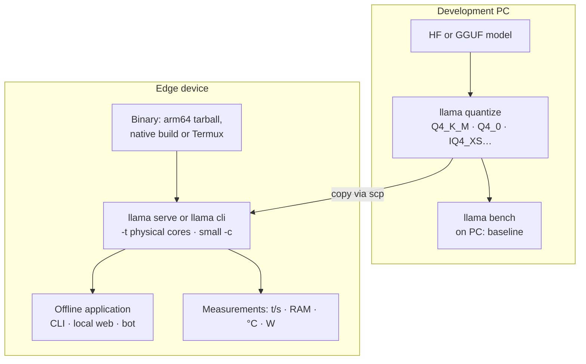

# P4: Inference on an edge device

:material-book-open-page-variant:{ .meta-icon } Modules [01](../../moduli/01-installazione/README.md), [03](../../moduli/03-modelli-gguf-quantizzazione/README.md), [05](../../moduli/05-prestazioni/README.md)
:material-target:{ .meta-icon } Difficulty ●●○

## Description

Bring a language model to a small device (Raspberry Pi 4/5, Android smartphone via Termux,
low-power ARM or x86 mini PC, an old laptop) and build a **useful offline application** on top of it:
a voice/text assistant for home automation, a pocket translator, a notes proofreader, a
message classifier, a summarizer of news downloaded once a day. The core of the project is the
trade-off between **quality, speed, memory and power consumption**: you choose and justify with measurements.

## Architecture

## Minimum requirements

- A working binary on the device: official tarball (`llama-bNNNNN-bin-ubuntu-arm64.tar.gz` or `-android-arm64`), installer, or a build from source on the device (Termux: `pkg install cmake clang git` then the normal build, see `docs/android.md`).
- Comparison of at least **3 quantizations** of the same model (e.g. Q8_0, Q4_K_M, IQ4_XS or Q4_0) and at least **2 models** of different sizes: `llama bench` for pp/tg, RAM used, and a small quality test (10-20 questions with expected answer, or perplexity with `llama perplexity` on a text).
- Measurement of **power consumption or temperature** during generation (USB power meter, `vcgencmd measure_temp`, `/sys/class/thermal`, battery on Android) and of the behavior under throttling.
- A working offline application: no network, automatic startup (systemd on the Pi, Termux script) and a suitable interface (CLI, local web page on the LAN, bot).
- README with the complete procedure starting from a blank device.

## Extensions for full marks

- Native build with specific flags (e.g. `-DGGML_NATIVE=ON` on the device, or Vulkan/OpenCL on Adreno for Android) compared with the generic binary.
- **Speculative decoding** with n-grams (`--spec-type ngram-simple`, no draft model) on repetitive tasks: measure the gain.
- Quantized KV cache (`-ctk q8_0 -ctv q8_0`) and `--load-mode mlock`/`mmap` compared on a device with little RAM and a slow SD card.
- A small multimodal model (`ggml-org/SmolVLM-256M-Instruct-GGUF` or `LFM2-VL-450M`) with the Pi camera: description of what it sees.
- An update pipeline for the model and the binary over the network when available, with rollback.
- Comparison of the Pi's ARM CPU with a mid-range smartphone: which costs less per token?

## Suggested milestones

| Week | Goal | Verifiable result |
|---|---|---|
| 1 | Binary on the device, first model in chat, `llama bench` working | pp/tg table for one model |
| 2 | Models × quantizations matrix: speed, RAM, quality, temperature/power; justified choice | bar chart + table |
| 3 | Application, automatic startup, README, report, demo | demo with the network unplugged |

## Recommended models

| Role | Repository | File / quant | Size | Notes |
|---|---|---|---|---|
| Tiny (Pi 4, 2-4 GB) | `LiquidAI/LFM2.5-230M-GGUF` | Q4_K_M / Q8_0 | 146 / 235 MiB | fast even on 4 ARM cores; acceptable Italian |
| Tiny (alternative) | `ggml-org/gemma-3-270m-it-GGUF` | Q8_0 | 278 MiB | excellent for classification and rephrasing |
| Small | `ggml-org/Qwen3.5-0.8B-GGUF` | Q4_0 / Q8_0 | 537 / 785 MiB | thinking off (`-rea off`) |
| Small (alternative) | `ggml-org/gemma-3-1b-it-GGUF` | Q4_K_M | 769 MiB | |
| Medium (Pi 5 8 GB, 12 GB phone) | `LiquidAI/LFM2.5-1.2B-Instruct-GGUF` | Q4_K_M | 697 MiB | |
| Medium (quality) | `ggml-org/SmolLM3-3B-GGUF` | Q4_K_M | 1.8 GiB | ~1-3 t/s on Pi 5: only for short tasks |
| Tiny vision | `ggml-org/SmolVLM-500M-Instruct-GGUF` | Q8_0 + mmproj | 417 + 104 MiB | |

For quantizations not present in the repo, start from the Q8_0 file (or from the HF model) and produce your own with
`llama quantize` on the PC (module 03).

## Specific grading criteria

- Models × quantizations table with pp/tg, RAM, quality and temperature/power, with written measurement conditions (`-t`, `-c`, build, power supply, cooling).
- The final choice is justified by the numbers (not "Q4_K_M because everyone says so").
- The application really works without a network and restarts on its own after a reboot.
- The README starts from a blank device (OS image, packages, binary, model) and a classmate has followed it.
- Honesty about limits: what the device cannot do and why (memory bandwidth, throttling, RAM).

## Known pitfalls

- On the Raspberry Pi **memory bandwidth** is the bottleneck: `-t 4` is not 4× faster than `-t 1`, and a Q4 is not 2× faster than a Q8. Measure.
- **Thermal throttling** skews benchmarks: measure the temperature, repeat (`-r 5`) and use a heatsink or a fan.
- Slow SD card + `mmap`: the first load takes minutes and generation stutters if the model does not fit in RAM; `--load-mode mlock` helps only if there is enough RAM.
- The `ubuntu-arm64` tarball requires a recent glibc: on an old Raspberry Pi OS or Termux you need the native build.
- On Android, Termux suspends in the background: the app must run in the foreground or with `termux-wake-lock`.
- Models under 1B follow long instructions poorly: short system prompts, examples in the prompt, output constrained with a grammar (module 06) to get reliable answers.
- A high `-c` on a 4 GB device eats the RAM the model needs: 1024-2048 tokens are almost always enough.

## Deliverables

- Repository with README, reproducible startup instructions and the llama.cpp version used (build and how it was obtained).
- Tables and charts of the measurements, with the conditions.
- Short report (problems encountered, choices, measurements) and 5-minute demo with the device disconnected from the network.

## Grading

See the [common rubric](../README.md#grading-rubric) plus the specific criteria above.
