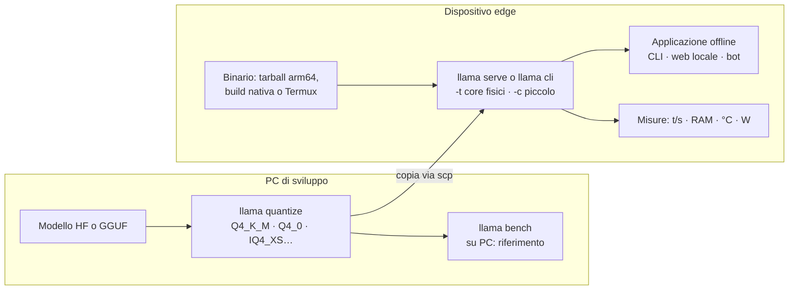

# P4: Inferenza su dispositivo edge

> Moduli di riferimento: [01](../../moduli/01-installazione/README.md), [03](../../moduli/03-modelli-gguf-quantizzazione/README.md), [05](../../moduli/05-prestazioni/README.md) · Difficoltà ●●○ · traccia completa · da verificare sul tuo dispositivo

## Descrizione

Portare un modello linguistico su un dispositivo piccolo (Raspberry Pi 4/5, smartphone Android via Termux,
mini PC ARM o x86 a basso consumo, un vecchio portatile) e costruirci sopra un'**applicazione offline utile**:
un assistente vocale-testuale per la domotica, un traduttore da tasca, un correttore di appunti, un
classificatore di messaggi, un riassuntore di notizie scaricate una volta al giorno. Il cuore del progetto è il
compromesso tra **qualità, velocità, memoria e consumo**: scegli e giustifichi con misure.

## Architettura

## Requisiti minimi

- Binario funzionante sul dispositivo: tarball ufficiale (`llama-bNNNNN-bin-ubuntu-arm64.tar.gz` o `-android-arm64`), installer, oppure build dai sorgenti sul dispositivo (Termux: `pkg install cmake clang git` poi la build normale, vedi `docs/android.md`).
- Confronto di almeno **3 quantizzazioni** dello stesso modello (es. Q8_0, Q4_K_M, IQ4_XS o Q4_0) e di almeno **2 modelli** di taglia diversa: `llama bench` per pp/tg, RAM usata, e un piccolo test di qualità (10-20 domande con risposta attesa, o perplexity con `llama perplexity` su un testo).
- Misura di **consumo o temperatura** durante la generazione (wattmetro USB, `vcgencmd measure_temp`, `/sys/class/thermal`, batteria su Android) e del comportamento sotto throttling.
- Applicazione offline funzionante: senza rete, avvio automatico (systemd sul Pi, script Termux) e un'interfaccia adatta (CLI, pagina web locale sulla LAN, bot).
- README con la procedura completa dal dispositivo vergine.

## Estensioni per il punteggio pieno

- Build nativa con flag specifici (es. `-DGGML_NATIVE=ON` sul dispositivo, o Vulkan/OpenCL su Adreno per Android) confrontata con il binario generico.
- **Decodifica speculativa** con n-gram (`--spec-type ngram-simple`, nessun modello bozza) su compiti ripetitivi: misura del guadagno.
- KV cache quantizzata (`-ctk q8_0 -ctv q8_0`) e `--load-mode mlock`/`mmap` a confronto su un dispositivo con poca RAM e scheda SD lenta.
- Modello multimodale piccolo (`ggml-org/SmolVLM-256M-Instruct-GGUF` o `LFM2-VL-450M`) con la camera del Pi: descrizione di ciò che vede.
- Pipeline di aggiornamento del modello e del binario via rete quando disponibile, con rollback.
- Confronto tra CPU ARM del Pi e uno smartphone di fascia media: quale costa meno per token?

## Tappe suggerite

| Settimana | Obiettivo | Risultato verificabile |
|---|---|---|
| 1 | Binario sul dispositivo, primo modello in chat, `llama bench` funzionante | tabella pp/tg per un modello |
| 2 | Matrice modelli × quantizzazioni: velocità, RAM, qualità, temperatura/consumo; scelta motivata | grafico a barre + tabella |
| 3 | Applicazione, avvio automatico, README, relazione, demo | demo con la rete staccata |

## Modelli consigliati

| Ruolo | Repository | File / quant | Dimensione | Note |
|---|---|---|---|---|
| Minuscolo (Pi 4, 2-4 GB) | `LiquidAI/LFM2.5-230M-GGUF` | Q4_K_M / Q8_0 | 146 / 235 MiB | veloce anche su 4 core ARM; italiano accettabile |
| Minuscolo (alternativa) | `ggml-org/gemma-3-270m-it-GGUF` | Q8_0 | 278 MiB | ottimo per classificazione e riformulazione |
| Piccolo | `ggml-org/Qwen3.5-0.8B-GGUF` | Q4_0 / Q8_0 | 537 / 785 MiB | thinking spento (`-rea off`) |
| Piccolo (alternativa) | `ggml-org/gemma-3-1b-it-GGUF` | Q4_K_M | 769 MiB | |
| Medio (Pi 5 8 GB, telefono 12 GB) | `LiquidAI/LFM2.5-1.2B-Instruct-GGUF` | Q4_K_M | 697 MiB | |
| Medio (qualità) | `ggml-org/SmolLM3-3B-GGUF` | Q4_K_M | 1,8 GiB | ~1-3 t/s su Pi 5: solo per compiti brevi |
| Visione minuscola | `ggml-org/SmolVLM-500M-Instruct-GGUF` | Q8_0 + mmproj | 417 + 104 MiB | |

Per le quantizzazioni non presenti nel repo, parti dal file Q8_0 (o dal modello HF) e produci le tue con
`llama quantize` sul PC (modulo 03).

## Criteri specifici di valutazione

- Tabella modelli × quantizzazioni con pp/tg, RAM, qualità e temperatura/consumo, condizioni di misura scritte (`-t`, `-c`, build, alimentazione, raffreddamento).
- La scelta finale è giustificata dai numeri (non "Q4_K_M perché lo dicono tutti").
- L'applicazione funziona davvero senza rete e riparte da sola dopo un riavvio.
- Il README parte dal dispositivo vergine (immagine OS, pacchetti, binario, modello) ed è stato seguito da un compagno.
- Onestà sui limiti: cosa il dispositivo non riesce a fare e perché (banda di memoria, throttling, RAM).

## Insidie note

- Su Raspberry Pi la **banda di memoria** è il collo di bottiglia: `-t 4` non è 4× più veloce di `-t 1`, e un Q4 non è 2× più veloce di un Q8. Misura.
- Il **throttling termico** falsa i benchmark: misura la temperatura, ripeti (`-r 5`) e usa un dissipatore o una ventola.
- Scheda SD lenta + `mmap`: il primo caricamento dura minuti e la generazione va a scatti se il modello non sta in RAM; `--load-mode mlock` aiuta solo se la RAM basta.
- Il tarball `ubuntu-arm64` richiede glibc recente: su Raspberry Pi OS vecchio o Termux serve la build nativa.
- Su Android, Termux si sospende in background: l'app deve girare in primo piano o con `termux-wake-lock`.
- Modelli sotto 1B seguono male le istruzioni lunghe: system prompt corti, esempi nel prompt, output vincolato con una grammatica (modulo 06) per ottenere risposte affidabili.
- `-c` alto su un dispositivo con 4 GB mangia la RAM che serve al modello: 1024-2048 token bastano quasi sempre.

## Consegna

- Repository con README, istruzioni di avvio riproducibili e versione di llama.cpp usata (build e come è stata ottenuta).
- Tabelle e grafici delle misure, con le condizioni.
- Breve relazione (problemi incontrati, scelte, misure) e demo di 5 minuti con il dispositivo scollegato dalla rete.

## Valutazione

Vedi [griglia comune](../README.md#griglia-di-valutazione) più i criteri specifici sopra.
