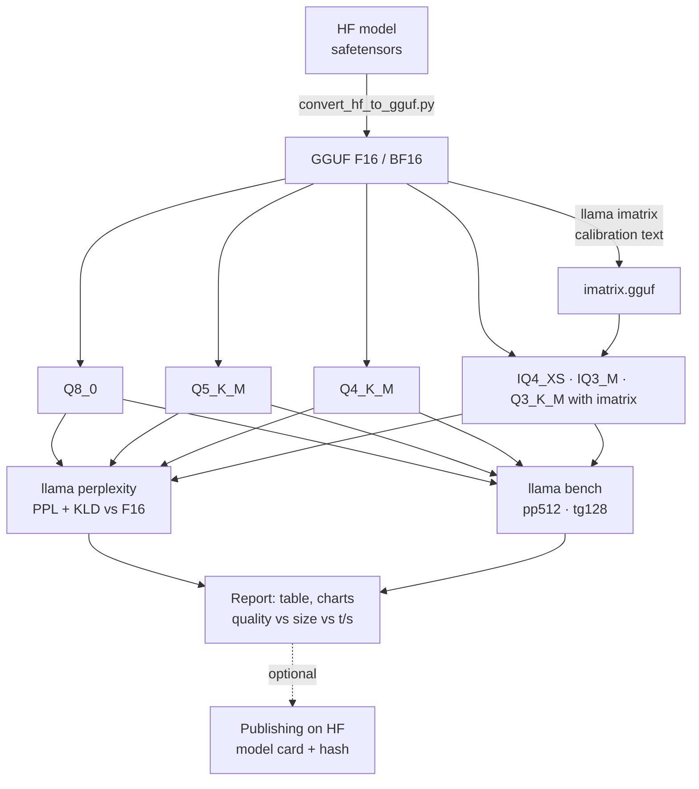

# P5: Conversion and evaluation pipeline

:material-book-open-page-variant:{ .meta-icon } Modules [03](../../moduli/03-modelli-gguf-quantizzazione/README.md), [05](../../moduli/05-prestazioni/README.md)
:material-target:{ .meta-icon } Difficulty ●●●

## Description

An **automatic and reproducible** pipeline that, given the name of a Hugging Face model (safetensors), produces
its GGUF quantizations, evaluates them for **quality** (perplexity and KL divergence against the model in
F16/BF16) and **speed** (`llama bench`), and publishes a report with charts and a recommendation ("for 8 GB
use X, for maximum quality Y"). This is the project for anyone who wants to understand what lies behind the
"GGUF" model cards you find on Hugging Face and, perhaps, publish one of their own.

## Architecture

## Minimum requirements

- A script (Make, bash, Python or Snakemake) that runs the **whole** chain from a single command: download, conversion with `convert_hf_to_gguf.py` (from source or from the `full` Docker image), `llama imatrix`, `llama quantize` into at least 5 types, `llama perplexity` with `--kl-divergence` and `llama bench`.
- At least one model with 0.1-1B parameters taken all the way through; calibration and evaluation texts that are **different** and documented (language, size).
- Automatically generated report (Markdown or HTML) with a table: type, size on disk, PPL, mean and p99 KLD, pp and tg t/s; charts of PPL vs size and tg vs size.
- Automatic functional check of each GGUF (a test question with `llama cli -st`).
- Reproducibility: pinned build (`llama version`), seed, logged commands, SHA-256 hashes of the produced files.

## Extensions for full marks

- A second model of a different size or architecture (e.g. a small MoE or a model with a `gemma`/`llama` template) and comparison of the curves.
- **Publishing** on Hugging Face (your own repo) with a model card generated by the pipeline, the `llama.cpp` tag and proof that `llama cli -hf tuo-utente/tuo-repo` works.
- Task-based evaluation (10-30 multiple-choice or exact-answer questions) in addition to PPL/KLD, and a discussion of when the two measures disagree.
- KV cache quantization and Flash Attention in the benchmark: how t/s and memory change.
- Comparison of imatrix with different calibration texts (Italian vs English, code vs prose) on KLD.
- Containerized pipeline (`ghcr.io/ggml-org/llama.cpp:full-bNNNNN`) with `compose.yaml`, or as a CI workflow.

## Suggested milestones

| Week | Goal | Verifiable result |
|---|---|---|
| 1 | Manual conversion and 2 quantizations, PPL by hand; then the first end-to-end script | `make tutto` produces 2 GGUFs and one PPL |
| 2 | imatrix, 5+ types, KLD, bench, automatic report | report with table and 2 charts |
| 3 | Second model or publishing, README, report, demo | a classmate regenerates the report from scratch |

## Recommended models

| Role | Repository (safetensors) | Source size | Notes |
|---|---|---|---|
| First model (fast, CPU) | `HuggingFaceTB/SmolLM2-135M-Instruct` | 257 MiB | conversion and all quantizations in a few minutes |
| Main model | `Qwen/Qwen2.5-0.5B-Instruct` | 942 MiB | very well-supported architecture, results comparable with `ggml-org/Qwen2.5-Coder-0.5B-Q8_0-GGUF` |
| Main model (recent) | `Qwen/Qwen3.5-0.8B` | 1.7 GiB | compare with the official GGUFs `ggml-org/Qwen3.5-0.8B-GGUF` (Q8_0 795 MiB, Q4_0 537 MiB) |
| With GPU / 32 GB RAM | `Qwen/Qwen2.5-Coder-1.5B-Instruct` or a 3-4B | 3-8 GiB | perplexity on the F16 of a 4B needs ~10 GB |

Tools: `llama quantize`, `llama perplexity`, `llama bench` are in the installer binary; `llama-imatrix`
is in the **release tarball** (or in the build from source); `convert_hf_to_gguf.py` is in the source code and
in the `full` Docker image.

## Specific grading criteria

- A single command regenerates everything; the results match (within noise) those in the report.
- PPL and KLD measured on the **same** text and with the same context (`-c`) for all quantizations; the evaluation text is not the calibration text.
- The report answers a practical question ("which quantization for 8 GB?") and the answer is consistent with the numbers.
- Quantizations with imatrix are compared with the same ones without it (where it makes sense, e.g. IQ4_XS, Q3_K_M).
- Hashes and versions of the produced files are in the report.

## Known pitfalls

- `llama perplexity` on the F16 of a 1B model with `-c 2048` and a few hundred chunks can take **hours** on CPU: limit the chunks (`--chunks`) and state it, or use the reduced text for all variants.
- KLD first requires saving the reference logits (`--kl-divergence-base file`) and then comparing against them: two passes, disk space needed (logits are large).
- PPLs compared on different texts mean nothing; and the PPL of an *instruct* model on prose does not measure how well it follows instructions: that is what tasks are for.
- Low-bit quantizations **without** imatrix can be terrible: that is the expected result, not a bug.
- Some models have a tokenizer or template not supported by the conversion script as of the build date: pick one of those above before falling in love with an exotic architecture.
- Disk space: a 1B model in F16 + 6 quantizations + logits ≈ 10 GB. Clean up between one model and the next.
- Benchmarks on a machine with other active processes or with throttling have high variance: use `-r 5` and report the standard deviation that `llama bench` prints.

## Deliverables

- Repository with the pipeline script, README, reproducible instructions and the llama.cpp version used.
- Generated report (Markdown/HTML) with table, charts, hashes and recommendation; the GGUFs **not** in the repo (HF link or instructions to regenerate them).
- Short report (problems encountered, choices, measurements) and 5-minute demo.

## Grading

See the [common rubric](../README.md#grading-rubric) plus the specific criteria above.
