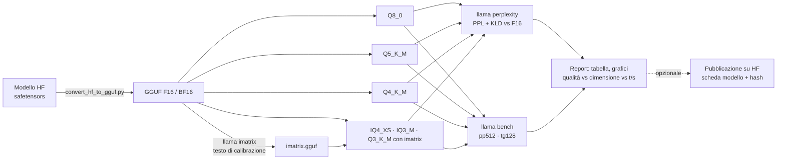

# P5: Pipeline di conversione e valutazione

> Moduli di riferimento: [03](../../moduli/03-modelli-gguf-quantizzazione/README.md), [05](../../moduli/05-prestazioni/README.md) · Difficoltà ●●● · traccia completa

## Descrizione

Una pipeline **automatica e riproducibile** che, dato il nome di un modello Hugging Face (safetensors), produce
le sue quantizzazioni GGUF, le valuta per **qualità** (perplexity e divergenza KL rispetto al modello in
F16/BF16) e **velocità** (`llama bench`), e pubblica un report con grafici e una raccomandazione ("per 8 GB
usa X, per la massima qualità Y"). È il progetto per chi vuole capire cosa c'è dietro le schede modello
"GGUF" che trovi su Hugging Face e, magari, pubblicarne una propria.

## Architettura

## Requisiti minimi

- Uno script (Make, bash, Python o Snakemake) che esegue **tutta** la catena da un solo comando: download, conversione con `convert_hf_to_gguf.py` (dai sorgenti o dall'immagine Docker `full`), `llama imatrix`, `llama quantize` in almeno 5 tipi, `llama perplexity` con `--kl-divergence` e `llama bench`.
- Almeno un modello da 0,1-1B parametri portato fino in fondo; testo di calibrazione e di valutazione **diversi** e documentati (lingua, dimensione).
- Report generato automaticamente (Markdown o HTML) con tabella: tipo, dimensione su disco, PPL, KLD media e p99, pp e tg t/s; grafici PPL vs dimensione e tg vs dimensione.
- Verifica funzionale automatica di ogni GGUF (una domanda di prova con `llama cli -st`).
- Riproducibilità: build fissata (`llama version`), seed, comandi loggati, hash SHA-256 dei file prodotti.

## Estensioni per il punteggio pieno

- Secondo modello di taglia o architettura diversa (es. MoE piccolo o un modello con `gemma`/`llama` template) e confronto delle curve.
- **Pubblicazione** su Hugging Face (repo tuo) con scheda modello generata dalla pipeline, tag `llama.cpp` e prova che `llama cli -hf tuo-utente/tuo-repo` funziona.
- Valutazione su compiti (10-30 domande a scelta multipla o esatte) oltre a PPL/KLD, e discussione di quando le due misure non concordano.
- Quantizzazione della KV cache e Flash Attention nel benchmark: come cambiano t/s e memoria.
- Confronto imatrix con testi di calibrazione diversi (italiano vs inglese, codice vs prosa) sulla KLD.
- Pipeline in container (`ghcr.io/ggml-org/llama.cpp:full-bNNNNN`) con `compose.yaml`, o come workflow di CI.

## Tappe suggerite

| Settimana | Obiettivo | Risultato verificabile |
|---|---|---|
| 1 | Conversione manuale e 2 quantizzazioni, PPL a mano; poi il primo script end-to-end | `make tutto` produce 2 GGUF e una PPL |
| 2 | imatrix, 5+ tipi, KLD, bench, report automatico | report con tabella e 2 grafici |
| 3 | Secondo modello o pubblicazione, README, relazione, demo | un compagno rigenera il report da zero |

## Modelli consigliati

| Ruolo | Repository (safetensors) | Dimensione sorgente | Note |
|---|---|---|---|
| Primo modello (veloce, CPU) | `HuggingFaceTB/SmolLM2-135M-Instruct` | 257 MiB | conversione e tutte le quantizzazioni in pochi minuti |
| Modello principale | `Qwen/Qwen2.5-0.5B-Instruct` | 942 MiB | architettura molto supportata, risultati confrontabili con `ggml-org/Qwen2.5-Coder-0.5B-Q8_0-GGUF` |
| Modello principale (recente) | `Qwen/Qwen3.5-0.8B` | 1,7 GiB | confronta con i GGUF ufficiali `ggml-org/Qwen3.5-0.8B-GGUF` (Q8_0 795 MiB, Q4_0 537 MiB) |
| Con GPU / 32 GB RAM | `Qwen/Qwen2.5-Coder-1.5B-Instruct` o un 3-4B | 3-8 GiB | la perplexity su F16 di un 4B richiede ~10 GB |

Strumenti: `llama quantize`, `llama perplexity`, `llama bench` sono nel binario dell'installer; `llama-imatrix`
è nel **tarball della release** (o nella build dai sorgenti); `convert_hf_to_gguf.py` è nei sorgenti e
nell'immagine Docker `full`.

## Criteri specifici di valutazione

- Un solo comando rigenera tutto; i risultati coincidono (entro il rumore) con quelli nel report.
- PPL e KLD misurate sullo **stesso** testo e con lo stesso contesto (`-c`) per tutte le quantizzazioni; il testo di valutazione non è quello di calibrazione.
- Il report risponde a una domanda pratica ("quale quantizzazione per 8 GB?") e la risposta è coerente con i numeri.
- Le quantizzazioni con imatrix sono confrontate con le stesse senza (dove ha senso, es. IQ4_XS, Q3_K_M).
- Hash e versione dei file prodotti sono nel report.

## Insidie note

- `llama perplexity` su F16 di un modello da 1B con `-c 2048` e qualche centinaio di chunk può richiedere **ore** su CPU: limita i chunk (`--chunks`) e dichiaralo, o usa il testo ridotto per tutte le varianti.
- La KLD richiede prima di salvare i logit del riferimento (`--kl-divergence-base file`) e poi confrontarli: due passaggi, disco necessario (i logit pesano).
- PPL confrontate su testi diversi non significano nulla; e la PPL di un modello *instruct* su prosa non misura quanto è bravo a seguire istruzioni: per questo servono i compiti.
- Le quantizzazioni a pochi bit **senza** imatrix possono essere pessime: è il risultato atteso, non un errore.
- Alcuni modelli hanno il tokenizer o il template non supportati dallo script di conversione alla data della build: scegline uno tra quelli sopra prima di innamorarti di un'architettura esotica.
- Spazio su disco: un modello da 1B in F16 + 6 quantizzazioni + logit ≈ 10 GB. Pulisci tra un modello e l'altro.
- Il benchmark su una macchina condivisa o con throttling ha varianza alta: `-r 5` e riporta la deviazione standard che `llama bench` stampa.

## Consegna

- Repository con lo script della pipeline, README, istruzioni riproducibili e versione di llama.cpp usata.
- Report generato (Markdown/HTML) con tabella, grafici, hash e raccomandazione; i GGUF **non** nel repo (link HF o istruzioni per rigenerarli).
- Breve relazione (problemi incontrati, scelte, misure) e demo di 5 minuti.

## Valutazione

Vedi [griglia comune](../README.md#griglia-di-valutazione) più i criteri specifici sopra.
