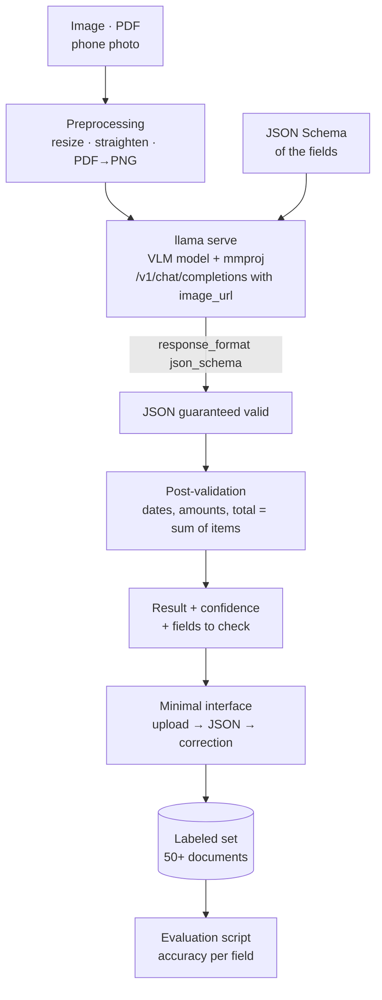

# P6: Data extraction from documents and images

:material-book-open-page-variant:{ .meta-icon } Modules [06](../../moduli/06-output-strutturato/README.md), [07](../../moduli/07-multimodale/README.md)
:material-target:{ .meta-icon } Difficulty ●●○

## Description

A service that receives **scans, photos of receipts and invoices, filled-in forms, photographed tables** and
returns **structured data** (valid JSON according to a schema you define: date, total, VAT, line items,
supplier…) using a local vision-language model with `llama serve`. No external OCR, no
cloud: the image goes into the model and the JSON comes out constrained by the schema. The project lives on a good
**accuracy measurement** on a hand-labeled set.

## Architecture

## Minimum requirements

- Input: images (JPG/PNG) and PDFs (converted to images page by page); minimal preprocessing (resizing to a fixed size, orientation).
- Extraction through `/v1/chat/completions` with `image_url` and **`response_format` with JSON Schema** (module 06): the output is always valid against the schema.
- Post-validation in code: date and amount formats, consistency (total ≈ sum of items + VAT), required fields; flagging of doubtful fields.
- A labeled set of at least **50 documents** (partly generated/synthetic is fine, but with at least 20 real photos) and a script that computes accuracy **per field** (exact for dates/amounts, fuzzy for names) and the rate of fully correct documents.
- Comparison of **two models** or two configurations (e.g. image resolution, prompt with/without examples).
- Minimal interface: an upload web page that shows the image and the JSON and lets you correct it (corrections feed the set).

## Extensions for full marks

- **Document-specialized model** (`ggml-org/granite-docling-258M-GGUF`) as a first pass (layout, text, tables) and a text LLM for the structure: comparison with the "all-in-one" VLM.
- Tables: extraction of rows/columns with a list-of-objects schema and per-cell measurement.
- Nightly batch: input folder → output JSON, with `llama serve -np 2` and throughput measurement (documents/hour).
- Search over the extracted documents (SQLite) with natural-language questions → SQL (module 06, constrained output).
- Multipage documents: merging per-page results and handling items that continue on the next page.
- Resolution vs accuracy vs time comparison (`--image-max-tokens`): where is the knee of the curve?

## Suggested milestones

| Week | Goal | Verifiable result |
|---|---|---|
| 1 | JSON schema, 10 photographed receipts, extraction with a VLM via curl, post-validation | 10 valid JSONs, accuracy by eye |
| 2 | Set of 50, per-field accuracy script, comparison of 2 models/configurations | per-field accuracy table per model |
| 3 | Interface, extension, README, report, demo | a classmate uploads a photo and gets the JSON |

## Recommended models

| Role | Repository | File / quant | Size | Notes |
|---|---|---|---|---|
| Small VLM (8 GB) | `ggml-org/SmolVLM-500M-Instruct-GGUF` | Q8_0 + mmproj Q8_0 | 417 + 104 MiB | fast; reads small text poorly |
| Small VLM (alternative) | `ggml-org/LFM2-VL-450M-GGUF` | Q8_0 + mmproj | 362 + 99 MiB | |
| Documents (layout, tables) | `ggml-org/granite-docling-258M-GGUF` | Q8_0 + mmproj | 170 + 99 MiB | DocTags/Markdown output, not general chat |
| Medium VLM (16 GB) | `ggml-org/gemma-3-4b-it-qat-GGUF` | Q4_0 + mmproj f16 | 2.4 GiB + 812 MiB | the best on CPU for receipts and forms |
| Medium VLM (alternative) | `unsloth/Qwen3.5-4B-GGUF` | Q4_K_M + mmproj F16 | 2.6 GiB + 641 MiB | excellent OCR; thinking off |
| Medium VLM (2B) | `ggml-org/SmolVLM2-2.2B-Instruct-GGUF` | Q4_K_M + mmproj | 1.0 GiB + 565 MiB | |
| With GPU | `ggml-org/gemma-4-E4B-it-GGUF` | Q4_0 + mmproj Q8_0 | 4.3 GiB + 534 MiB | also audio and PDF in the web UI |

With `-hf` the server downloads the repo's `mmproj` on its own. Startup: `llama serve -hf ggml-org/gemma-3-4b-it-qat-GGUF -c 4096`.

## Specific grading criteria

- The JSON is **always** valid (the schema guarantees it) and post-validation flags inconsistent cases: demonstrated with examples.
- Accuracy per field and per document, with an analysis of the most frequent errors (which field, which type of photo).
- The comparison between models/configurations is done on the same set and with the same script.
- The labeled set is delivered (or described if it contains personal data: in that case anonymized or synthetic) and reproducible.
- Times per document reported with the hardware used.

## Known pitfalls

- The JSON schema guarantees the **shape**, not the **truth**: a small model produces a plausible but wrong total; that is why you need post-validation and a labeled set.
- Crooked, blurry, shadowed photos: preprocessing matters more than the prompt. Try resizing to 1024 px on the long side and compare.
- VLM models have a maximum number of image tokens (`--image-max-tokens`): high resolutions get reduced and small text disappears. Crop the areas that matter or work page by page.
- Prompt processing of an image on CPU costs seconds or tens of seconds: `-np 2` does not double the speed; measure documents/hour.
- Dates in Italian format (`12/03/2026`) often get "Americanized": specify the format in the schema (pattern) and in the prompt.
- Personal data on receipts and invoices: use your own or synthetic documents; don't upload third-party photos to the repo.
- Schemas with too many optional or nested fields make small models worse: start from 6-8 flat fields, then grow.

## Deliverables

- Repository with README, reproducible startup instructions and the llama.cpp version used.
- JSON schema, labeled set (or its anonymized version), evaluation script and results table.
- Short report (problems encountered, choices, measurements) with error analysis and 5-minute demo.

## Grading

See the [common rubric](../README.md#grading-rubric) plus the specific criteria above.
