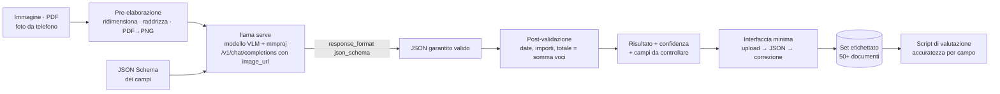

# P6: Estrazione dati da documenti e immagini

> Moduli di riferimento: [06](../../moduli/06-output-strutturato/README.md), [07](../../moduli/07-multimodale/README.md) · Difficoltà ●●○ · traccia completa

## Descrizione

Un servizio che riceve **scansioni, foto di scontrini e fatture, moduli compilati, tabelle fotografate** e
restituisce **dati strutturati** (JSON valido secondo uno schema che definisci tu: data, totale, IVA, voci,
fornitore…) usando un modello visione-linguaggio in locale con `llama serve`. Niente OCR esterno, niente
cloud: l'immagine entra nel modello e il JSON esce vincolato dallo schema. Il progetto vive di una buona
**misura dell'accuratezza** su un set etichettato a mano.

## Architettura

## Requisiti minimi

- Input: immagini (JPG/PNG) e PDF (convertiti in immagini pagina per pagina); pre-elaborazione minima (ridimensionamento a una dimensione fissa, orientamento).
- Estrazione tramite `/v1/chat/completions` con `image_url` e **`response_format` con JSON Schema** (modulo 06): l'output è sempre valido rispetto allo schema.
- Post-validazione nel codice: formati di data e importo, coerenza (totale ≈ somma delle voci + IVA), campi obbligatori; segnalazione dei campi dubbi.
- Set etichettato di almeno **50 documenti** (anche generati/sintetici in parte, ma con almeno 20 foto vere) e script che calcola l'accuratezza **per campo** (esatta per date/importi, fuzzy per nomi) e il tasso di documenti completamente corretti.
- Confronto tra **due modelli** o due configurazioni (es. risoluzione dell'immagine, prompt con/senza esempi).
- Interfaccia minima: pagina web di upload che mostra l'immagine, il JSON e permette di correggerlo (le correzioni alimentano il set).

## Estensioni per il punteggio pieno

- **Modello specializzato per documenti** (`ggml-org/granite-docling-258M-GGUF`) come primo passaggio (layout, testo, tabelle) e un LLM di testo per la struttura: confronto con il VLM "tutto in uno".
- Tabelle: estrazione di righe/colonne con schema a lista di oggetti e misura per cella.
- Batch notturno: cartella di ingresso → JSON in uscita, con `llama serve -np 2` e misura del throughput (documenti/ora).
- Ricerca sui documenti estratti (SQLite) con domande in linguaggio naturale → SQL (modulo 06, output vincolato).
- Documenti multipagina: unione dei risultati per pagina e gestione delle voci che continuano nella pagina successiva.
- Confronto risoluzione vs accuratezza vs tempo (`--image-max-tokens`): dove sta il ginocchio della curva?

## Tappe suggerite

| Settimana | Obiettivo | Risultato verificabile |
|---|---|---|
| 1 | Schema JSON, 10 scontrini fotografati, estrazione con un VLM via curl, post-validazione | 10 JSON validi, accuratezza a occhio |
| 2 | Set da 50, script di accuratezza per campo, confronto tra 2 modelli/configurazioni | tabella accuratezza per campo per modello |
| 3 | Interfaccia, estensione, README, relazione, demo | un compagno carica una foto e ottiene il JSON |

## Modelli consigliati

| Ruolo | Repository | File / quant | Dimensione | Note |
|---|---|---|---|---|
| VLM piccolo (8 GB) | `ggml-org/SmolVLM-500M-Instruct-GGUF` | Q8_0 + mmproj Q8_0 | 417 + 104 MiB | veloce; testo piccolo letto male |
| VLM piccolo (alternativa) | `ggml-org/LFM2-VL-450M-GGUF` | Q8_0 + mmproj | 362 + 99 MiB | |
| Documenti (layout, tabelle) | `ggml-org/granite-docling-258M-GGUF` | Q8_0 + mmproj | 170 + 99 MiB | output DocTags/Markdown, non chat generica |
| VLM medio (16 GB) | `ggml-org/gemma-3-4b-it-qat-GGUF` | Q4_0 + mmproj f16 | 2,4 GiB + 812 MiB | il migliore su CPU per scontrini e moduli |
| VLM medio (alternativa) | `unsloth/Qwen3.5-4B-GGUF` | Q4_K_M + mmproj F16 | 2,6 GiB + 641 MiB | ottimo OCR; thinking spento |
| VLM medio (2B) | `ggml-org/SmolVLM2-2.2B-Instruct-GGUF` | Q4_K_M + mmproj | 1,0 GiB + 565 MiB | |
| Con GPU | `ggml-org/gemma-4-E4B-it-GGUF` | Q4_0 + mmproj Q8_0 | 4,3 GiB + 534 MiB | anche audio e PDF nella web UI |

Con `-hf` il server scarica da solo l'`mmproj` del repo. Avvio: `llama serve -hf ggml-org/gemma-3-4b-it-qat-GGUF -c 4096`.

## Criteri specifici di valutazione

- Il JSON è **sempre** valido (lo garantisce lo schema) e la post-validazione segnala i casi incoerenti: dimostrato con esempi.
- Accuratezza per campo e per documento, con un'analisi degli errori più frequenti (quale campo, quale tipo di foto).
- Il confronto tra modelli/configurazioni è fatto sullo stesso set e con lo stesso script.
- Il set etichettato è consegnato (o descritto se contiene dati personali: allora anonimizzato o sintetico) e riproducibile.
- Tempi per documento riportati con l'hardware usato.

## Insidie note

- Lo schema JSON garantisce la **forma**, non la **verità**: un modello piccolo produce un totale plausibile ma sbagliato; per questo servono post-validazione e set etichettato.
- Foto storte, sfocate, con ombre: la pre-elaborazione conta più del prompt. Prova a ridimensionare a 1024 px sul lato lungo e confronta.
- I modelli VLM hanno un numero massimo di token immagine (`--image-max-tokens`): risoluzioni alte vengono ridotte e il testo piccolo sparisce. Ritaglia le zone che contano o lavora per pagina.
- Il prompt processing di un'immagine su CPU costa secondi o decine di secondi: `-np 2` non raddoppia la velocità; misura documenti/ora.
- Le date in formato italiano (`12/03/2026`) vengono spesso "americanizzate": specifica il formato nello schema (pattern) e nel prompt.
- Dati personali su scontrini e fatture: usa documenti tuoi o sintetici; non caricare nel repo foto di terzi.
- Schemi con troppi campi opzionali o annidati peggiorano i modelli piccoli: parti da 6-8 campi piatti, poi cresci.

## Consegna

- Repository con README, istruzioni di avvio riproducibili e versione di llama.cpp usata.
- Schema JSON, set etichettato (o sua versione anonimizzata), script di valutazione e tabella dei risultati.
- Breve relazione (problemi incontrati, scelte, misure) con analisi degli errori e demo di 5 minuti.

## Valutazione

Vedi [griglia comune](../README.md#griglia-di-valutazione) più i criteri specifici sopra.
