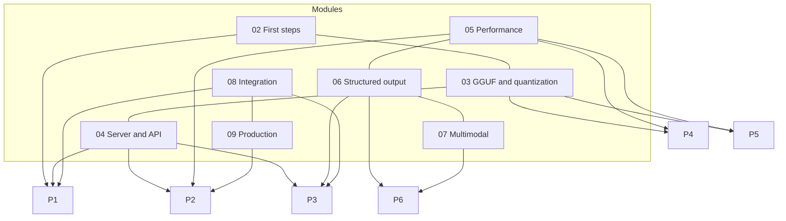

# Final projects

You (or a group of 2-3 people) choose **one** project and complete it in **three weeks**.
Each project combines several modules, produces something usable, and must be documented so that a classmate can
reproduce it by following the README. The briefs are deliberately open: the minimum requirements are the floor,
the extensions are the ceiling.

| # | Project | Modules | Difficulty | Minimum hardware |
|---|---|---|---|---|
| [P1](P1-assistente-rag-locale/README.md) | Local document assistant (RAG) | 02, 04, 08 | ●●○ | CPU, 8 GB |
| [P2](P2-server-inferenza-produzione/README.md) | Inference server in production | 04, 05, 09 | ●●○ | a Linux VM/VPS, 8 GB |
| [P3](P3-agente-tool-calling/README.md) | Agent with tools | 04, 06, 08 | ●●● | CPU, 8-16 GB |
| [P4](P4-edge-offline/README.md) | Inference on an edge device | 01, 03, 05 | ●●○ | Raspberry Pi 4/5, Android or mini PC |
| [P5](P5-pipeline-quantizzazione/README.md) | Conversion and evaluation pipeline | 03, 05 | ●●● | CPU, 16 GB (a GPU helps) |
| [P6](P6-estrazione-documenti-multimodale/README.md) | Data extraction from documents and images | 06, 07 | ●●○ | CPU, 8-16 GB |

## How the work is organized

- **Week 1**: choose the model and build an "ugly but working" prototype (end-to-end, even with a single example).
- **Week 2**: measurements, comparison between alternatives (models, quantizations, parameters), justified choices.
- **Week 3**: cleanup, reproducible README, report, demo.

Each brief lists the suggested milestones week by week, the recommended models with their sizes,
the specific grading criteria, and the most frequent pitfalls in this kind of project.

## Deliverables (common to all)

- Git repository with a README: hardware requirements, installation and startup commands, **llama.cpp version**
  used (`llama version` → build), models with Hugging Face repo, file and size.
- Script or `compose.yaml` that recreates the environment; no `.gguf` files in the repository (download them with `llama download`).
- Report of 3-6 pages: problem, architecture, choices with the measurements that justify them, problems encountered, limits.
- 5-minute demo, live or recorded.

## Grading rubric

| Criterion | Weight | What we look at |
|---|---|---|
| It works and is reproducible by following the README | 30% | a grader installs it on a clean machine and gets the same result |
| Justified technical choices (model, quantization, parameters) with measurements | 25% | tables and charts, not opinions: t/s, RAM, accuracy, latency |
| Quality of code and configuration | 20% | readable, commented code with no secrets; explicit configuration |
| Report and demo | 15% | clarity, honesty about limits, ability to answer questions |
| Extensions | 10% | at least one of those proposed in the brief, or an equivalent one agreed upon |

Each brief adds **specific criteria** that detail the first two points for that project.

!!! tip "What makes the difference"
    Three things recur in the best projects: an **evaluation set** (even a small one, 20-50 cases) built
    before writing code; a **comparison of at least two models** on the same cases; a README that a
    classmate has actually tried to follow.
