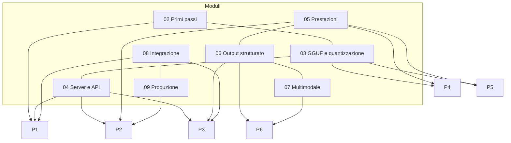

# Progetti di fine corso

Lo studente (o un gruppo di 2-3 persone) sceglie **un** progetto e lo porta a termine in **tre settimane**.
Ogni progetto combina più moduli, produce qualcosa di usabile e va documentato in modo che un compagno possa
riprodurlo seguendo il README. Le tracce sono volutamente aperte: i requisiti minimi sono il pavimento, le
estensioni sono il tetto.

| # | Progetto | Moduli | Difficoltà | Hardware minimo |
|---|---|---|---|---|
| [P1](P1-assistente-rag-locale/README.md) | Assistente documentale locale (RAG) | 02, 04, 08 | ●●○ | CPU, 8 GB |
| [P2](P2-server-inferenza-produzione/README.md) | Server di inferenza in produzione | 04, 05, 09 | ●●○ | una VM/VPS Linux, 8 GB |
| [P3](P3-agente-tool-calling/README.md) | Agente con strumenti | 04, 06, 08 | ●●● | CPU, 8-16 GB |
| [P4](P4-edge-offline/README.md) | Inferenza su dispositivo edge | 01, 03, 05 | ●●○ | Raspberry Pi 4/5, Android o mini PC |
| [P5](P5-pipeline-quantizzazione/README.md) | Pipeline di conversione e valutazione | 03, 05 | ●●● | CPU, 16 GB (GPU aiuta) |
| [P6](P6-estrazione-documenti-multimodale/README.md) | Estrazione dati da documenti e immagini | 06, 07 | ●●○ | CPU, 8-16 GB |

## Come si lavora

- **Settimana 1**: scelta del modello e prototipo "brutto ma funzionante" (end-to-end, anche con un solo esempio).
- **Settimana 2**: misure, confronto tra alternative (modelli, quantizzazioni, parametri), scelte motivate.
- **Settimana 3**: pulizia, README riproducibile, relazione, demo.

Ogni traccia riporta le tappe suggerite settimana per settimana, i modelli consigliati con le dimensioni,
i criteri specifici di valutazione e le insidie più frequenti in questo tipo di progetto.

## Consegna (comune a tutti)

- Repository (Git) con README: requisiti hardware, comandi di installazione e avvio, **versione di llama.cpp**
  usata (`llama version` → build), modelli con repo Hugging Face, file e dimensione.
- Script o `compose.yaml` che ricrea l'ambiente; niente file `.gguf` nel repository (vanno scaricati con `llama download`).
- Relazione di 3-6 pagine: problema, architettura, scelte con le misure che le giustificano, problemi incontrati, limiti.
- Demo di 5 minuti dal vivo o registrata.

## Griglia di valutazione

| Criterio | Peso | Cosa guardiamo |
|---|---|---|
| Funziona ed è riproducibile seguendo il README | 30% | un valutatore lo installa su una macchina pulita e ottiene lo stesso risultato |
| Scelte tecniche motivate (modello, quantizzazione, parametri) con misure | 25% | tabelle e grafici, non opinioni: t/s, RAM, accuratezza, latenza |
| Qualità del codice e della configurazione | 20% | codice leggibile, commentato, senza segreti; configurazione esplicita |
| Relazione e demo | 15% | chiarezza, onestà sui limiti, capacità di rispondere alle domande |
| Estensioni | 10% | almeno una tra quelle proposte nella traccia, o una equivalente concordata |

Ogni traccia aggiunge **criteri specifici** che dettagliano i primi due punti per quel progetto.

!!! tip "Cosa fa la differenza"
    Tre cose ricorrenti nei progetti migliori: un **set di valutazione** (anche piccolo, 20-50 casi) costruito
    prima di scrivere codice; il **confronto tra almeno due modelli** con gli stessi casi; un README che un
    compagno ha davvero provato a seguire.
