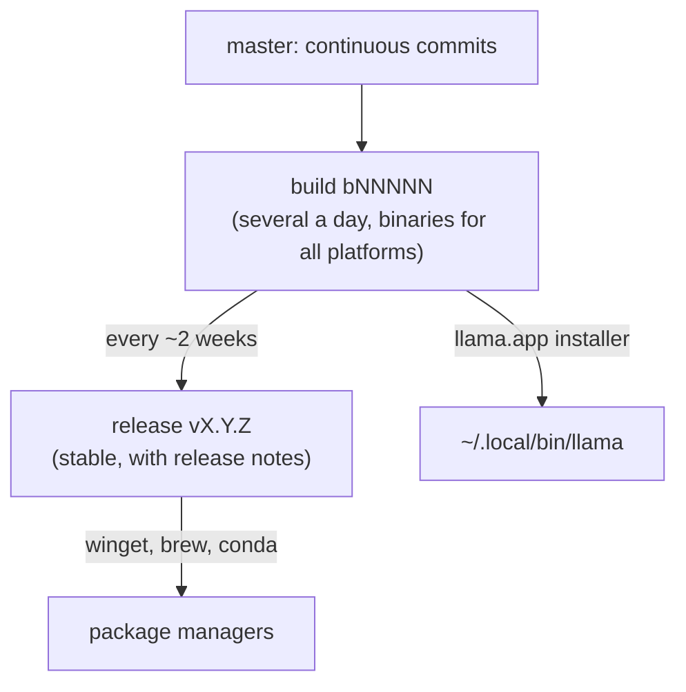

# Reference version

!!! warning "The course uses v0.4.1; llama.cpp is at v0.7.0"
    As of 10/28/2026 the latest stable release is **v0.7.0** (10/15/2026) and the latest build is `b11936`. The change
    that affects the course commands: **since v0.7.0 `llama serve` listens on port 9931 instead of 8080** (the Docker
    images stay on 8080 inside the container). Replace `8080` with `9931`, or add `--port 8080` when
    you start the server. New features introduced after v0.4.1: `--moe-cache-mib` (GPU cache for MoE experts kept in RAM),
    LiliCorr speculative decoding, ggml 0.27; for these see the [release notes](https://github.com/ggml-org/llama.cpp/releases).

llama.cpp publishes **several builds a day**. To avoid chasing them, the course uses one precise version:

| Field | Value |
|---|---|
| Build used in the course | **`b11046`**: `llama version` prints `version: 0.4.1-dev (build 11046, commit 60081bb2b)` |
| How to get it | official installer `curl -LsSf https://llama.app/install.sh \| sh` (it is the build the installer shipped on 09/22/2026); tarball [`llama-b11046-bin-*`](https://github.com/ggml-org/llama.cpp/releases/tag/b11046); sources: `git checkout b11046` |
| Closest stable release | [`v0.4.1`](https://github.com/ggml-org/llama.cpp/releases/tag/v0.4.1) of 09/14/2026 (corresponds to build `b10964`) |
| ggml | 0.24.0 |
| Latest build seen when the course was written | `b11095` (09/22/2026) |

## If you use a different version

That is fine: almost everything works the same. The things that change most often are:

- **binary names**: since 2026 there is the single `llama` command with subcommands (`llama cli`, `llama serve`, `llama bench`…).
  The old names `llama-cli`, `llama-server`, `llama-bench` still exist in the tarballs and in Docker, and many online
  tutorials use them: they are equivalent;
- **removed or renamed flags**: in 0.4.1 `--mmap`, `--mlock`, `--direct-io` became `--load-mode`;
  always check `llama <comando> --help`;
- **server port**: up to 0.6 `llama serve` uses 8080, from **0.7.0 it uses 9931**; with `--port` you choose;
- **supported models**: every build adds architectures; a new GGUF may require a new build.

## How to update the course to a new version

1. Install the new build (`llama update`), write down `llama version`.
2. Rerun labs 01, 02, 04 and 05 (they are the ones with the most commands).
3. Update the table above and the update dates of the pages you touched.
