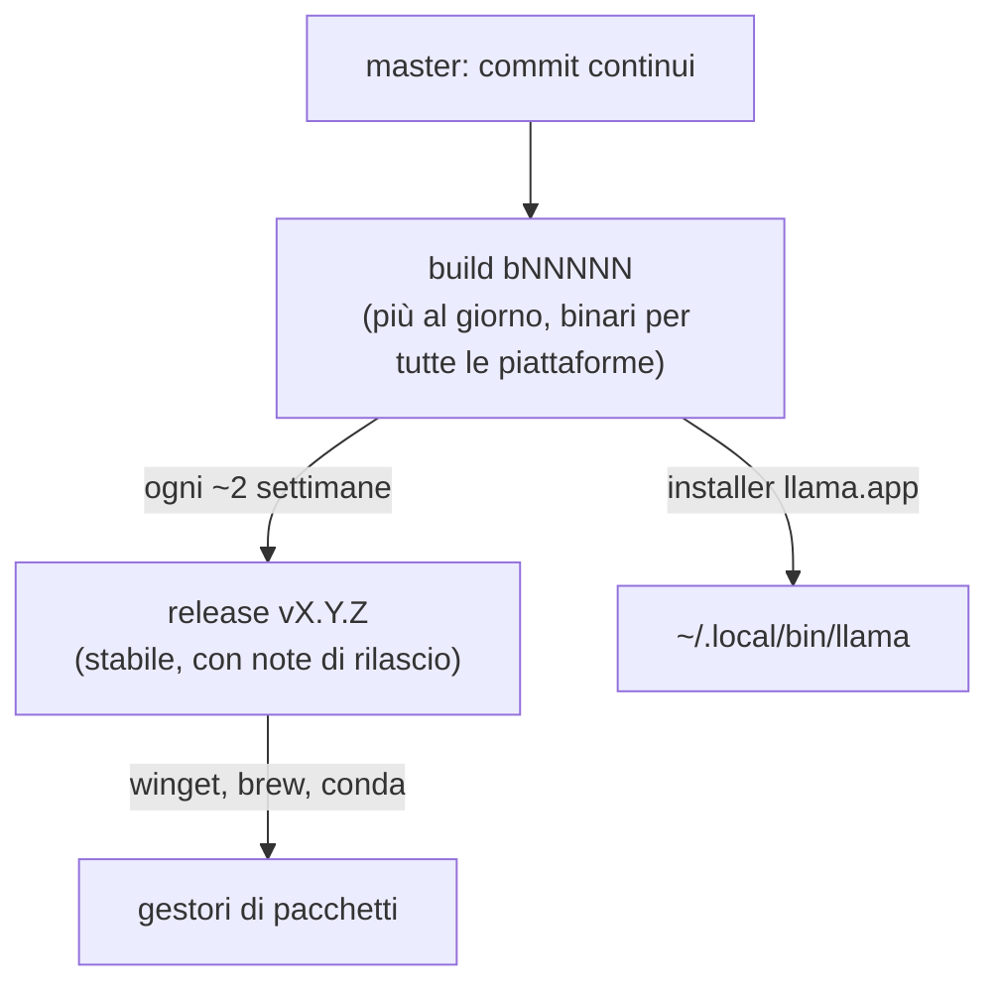

# Versione di riferimento

verificato il 22/09/2026 confronto con le versioni successive aggiornato al 28/10/2026

!!! warning "Attenzione: il corso è fermo alla v0.4.1, llama.cpp è già alla v0.7.0"
    Al 28/10/2026 l'ultima release stabile è la **v0.7.0** (15/10/2026) e l'ultima build è la `b11936`. Il cambiamento
    che tocca il corso: **dalla v0.7.0 `llama serve` ascolta sulla porta 9931 invece di 8080** (le immagini Docker
    restano su 8080 dentro il container). Nei comandi del corso sostituisci `8080` con `9931`, oppure aggiungi
    `--port 8080` quando avvii il server. Novità non coperte dal corso: `--moe-cache-mib` (cache GPU per gli esperti
    MoE tenuti in RAM), decodifica speculativa LiliCorr, ggml 0.27. L'aggiornamento del corso è previsto; fino ad allora
    vale questa nota.

llama.cpp pubblica **più build al giorno**. Per non inseguirle, il corso è scritto e provato su una versione precisa:

| Campo | Valore |
|---|---|
| Build usata nel corso | **`b11046`** — `llama version` stampa `version: 0.4.1-dev (build 11046, commit 60081bb2b)` |
| Come ottenerla | installer ufficiale `curl -LsSf https://llama.app/install.sh \| sh` (è la build che l'installer distribuiva il 22/09/2026); tarball [`llama-b11046-bin-*`](https://github.com/ggml-org/llama.cpp/releases/tag/b11046); sorgenti: `git checkout b11046` |
| Release stabile più vicina | [`v0.4.1`](https://github.com/ggml-org/llama.cpp/releases/tag/v0.4.1) del 14/09/2026 (corrisponde alla build `b10964`) |
| ggml | 0.24.0 |
| Ultima build vista quando il corso è stato scritto | `b11095` (22/09/2026) |

## Se usi una versione diversa

Va benissimo: quasi tutto funziona uguale. Le cose che cambiano più spesso sono:

- **nomi dei binari**: dal 2026 c'è il comando unico `llama` con sottocomandi (`llama cli`, `llama serve`, `llama bench`…).
  I vecchi nomi `llama-cli`, `llama-server`, `llama-bench` esistono ancora nei tarball e in Docker, e molti tutorial
  in rete li usano: sono equivalenti;
- **flag rimossi o rinominati**: in 0.4.1 `--mmap`, `--mlock`, `--direct-io` sono diventati `--load-mode`;
  controlla sempre `llama <comando> --help`;
- **porta del server**: fino alla 0.6 `llama serve` usa la 8080, dalla **0.7.0 la 9931**; con `--port` scegli tu;
- **modelli supportati**: ogni build aggiunge architetture; un GGUF nuovo può richiedere una build nuova.

## Come aggiornare il corso a una nuova versione

1. Installare la nuova build (`llama update`), annotare `llama version`.
2. Rieseguire i laboratori 01, 02, 04 e 05 (sono quelli con più comandi).
3. Aggiornare la tabella qui sopra e i badge di stato delle pagine toccate.
